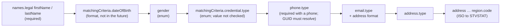

# Person matching requests (Banner)

What `PersonMixin.get_or_create_person` sends, and what Banner does with it. Verified
against SCCC's Ethos (Banner, EEDM) on 2026-09-22 (package_ethos#3). Ethos serves no
schema for this media type, so the field list below was mapped by probing.

## Every match request creates a prospect

`/admin/available-resources` shows that POST is accepted only with:

```
application/vnd.hedtech.integration.person-matching-requests-initiations-prospects.v1+json
```

So **every match request creates a Banner prospect record**, including requests sent
only to check whether a payload is accepted. To check a payload, run
`validate_person_match` (below), which sends nothing.

## What Banner validates

Banner checks one field at a time and stops at the first failure, in this order:



**Silently ignored:** `academicPeriod`, `academicLevel`, `program`, `admissionPopulation`,
`studentType`, `residencyType`, `educationalGoal`, `citizenshipStatus`, `races`,
`ethnicity`, `originator`, `names.personal`.

## "Degree not found" is not a payload problem

The schema has **no academic or curriculum input at all**. A tenant can still get

```
400 Global.SchemaValidation.Error / "Degree not found"
```

on a payload that holds only a name and a date of birth. That is Banner resolving a
prospect default degree internally, and nothing in the request can change it. Fix it in
Banner's prospect defaults, not in the payload.

## Reading the result

`get_or_create_person` returns `(request_id, person_guid, status, log)`, and
`get_request_status(request_id)` returns `(person_guid, status, log)`. `status` is the
first outcome's status, or `None` when Banner returns no outcomes. After a
`reviewRequired` match is resolved in Banner the request may keep its original status,
so **a returned person GUID wins over the status**.

## Tools

| Command | What it does |
|---|---|
| `populate_sis_guids [--dry-run] [--overwrite] [--only …]` | Reads the code tables (`races`, `ethnicities`, `phone-types`, `email-types`, `address-types`, `emergency-contact-types`) and fills the SIS GUIDS blob. Keys that already have a value are kept unless you pass `--overwrite`. |
| `validate_person_match <student>` | Applies Banner's validation rules locally and reports every failure at once. Sends nothing. |
